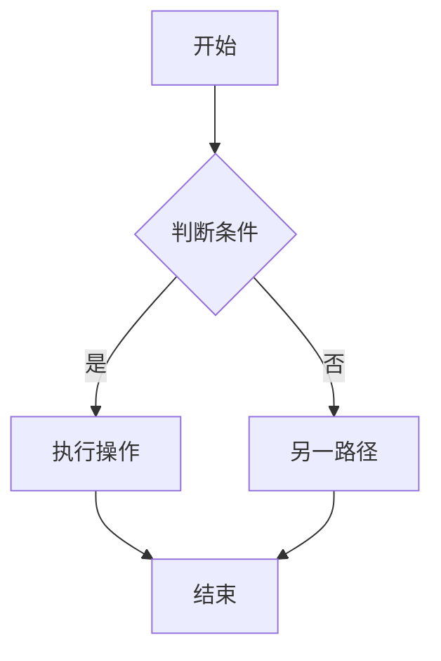

# PM 需求分析执行步骤

> 执行前必须 Read `${CLAUDE_SKILL_DIR}/../pm-common/project-management.md` 了解项目管理规范。

## 步骤 0：初始化项目骨架

1. 询问或确认项目名称
2. 检查 `output/[项目名]/` 是否存在：
   - **不存在**：创建目录骨架：
     ```
     output/[项目名]/
     ├── README.md          （用初始模板）
     ├── project-spec.md    （用初始模板）
     ├── .pm-state.json     （初始化，batch=B1, counters全0）
     └── analysis/           （空目录）
     ```
   - **已存在**：Read `.pm-state.json`，获取当前批次和 F 计数器
3. 如果 `.pm-state.json` 中 pm-analyze 的 status 为 `in_progress`，提示用户：
   ```
   检测到项目"[项目名]"上次在 pm-analyze 阶段中断。
   - 输入"继续"：从中断处继续
   - 输入"重新开始"：重新执行分析
   ```

## 步骤 0.5：检测项目初始化配置（可选）

检测顺序：① `--config <路径>` ② `output/[项目名]/project-config.md`。都不存在 → 跳过本步（现状兼容）。

存在则 Read，并按 project-management.md §十三 消费 PM 链相关节：
- **输入来源**（节 2）：需求/PRD 路径作为多格式需求抽取的输入源（进入步骤 1.5）
- **前端工程**（节 3）：本地路径 → 作为步骤 1.6「前端工程首轮匹配」的工程定位来源
- **待开发模块**（节 6）：作为功能清单种子（进入步骤 4，标注来源「配置」）
- **参考模块**（节 7）：并入步骤 1 的上下文读取，参考历史项目的分析报告/术语表（软参考）
- **备注约束**（节 8）：作为本次分析约束，append 到 project-spec「技术决策」
- 后端工程 / DB 脚本（节 4/5）PM 链不消费，留给研发链

## 步骤 1：读取项目上下文（规范引用铁律）

执行任何分析前，**必须按以下顺序读取上下文**（未读取不得进入步骤 2）：

1. **【强制】** 检查 `output/[项目名]/project-spec.md` 是否存在：
   - 如存在，Read 并提取：已有技术决策、业务术语表、接口清单、组件约定
   - 将其作为本次分析的约束（不得与已有决策矛盾）
2. 检查当前目录是否存在 `CLAUDE.md`，如有，读取其中的：
   - 技术栈信息（用于端类型推荐时参考）
   - 业务术语表（避免与已有术语冲突）
   - 已有功能模块（避免在功能清单中推荐已存在的功能）
3. 检查 `output/[项目名]/analysis/` 下是否有同项目的历史报告，如有，读取后在新报告中标注"新增/变更/不变"
4. 如无上下文文件，跳过此步骤继续

## 步骤 1.5：多格式需求抽取

当用户提供的输入不是纯文本时，按格式识别并结构化提取：

| 输入格式 | 识别方式 | 处理方法 |
|---------|---------|---------|
| 纯文本/Markdown | 直接粘贴或 .md/.txt 文件 | 直接分析 |
| PDF | .pdf 扩展名 | 使用 Read 工具读取，提取文本段落和表格结构 |
| 图片 | .png/.jpg/.jpeg/.gif/.webp | 使用 Read 工具读取（多模态识别），提取界面元素、文字内容、交互线索 |
| Excel/CSV | .xlsx/.xls/.csv | 使用 Read 工具读取，提取表格数据（功能清单、字段定义等） |
| 已有代码 | .vue/.js/.ts/.html/.java 等 | 使用 Read 工具读取，逆向提取业务逻辑和数据模型 |

**抽取规则**：
1. 用户提供文件路径时，根据扩展名自动判断格式并使用对应处理方法
2. 多个输入文件时，逐一 Read 后合并分析，冲突点列入待澄清问题
3. 分析报告中每条功能标注信息来源（如"来源：需求文档 P3"、"来源：截图-登录页"）
4. 图片输入：重点提取界面元素（按钮/表单/列表/导航）和文字标注，转化为功能点

## 步骤 1.6：前端工程首轮匹配（存量工程场景）

**触发条件**：存在可识别的已有前端工程时执行；纯新项目（无存量工程）跳过本步骤。

**目的**：先盘点再设计 —— 让"这个功能系统里是不是已经有了"变成有依据的判断，而不是到开发阶段才发现重复建设。

### 1.6.1 定位工程路径（按优先级）

1. 用户在触发词中给出的工程路径（如"前端交付：…，已有工程在 D:/my-project/frontend/"）
2. 项目初始化配置（`--config` / `project-config.md`）节 3「前端工程」的路径
3. `CLAUDE.md` 中声明的工程路径或"已有模块"清单
4. `project-spec.md` 中记录的历史工程路径
5. 自动探测当前目录下的常见结构：`src/views/`、`src/pages/`、`src/router/`
6. 以上均无 → **最多向用户确认一次**工程路径；用户未提供则跳过本步骤，并在报告中标注"未执行首轮匹配"

### 1.6.2 扫描已有实现

Read 以下内容，建立"已有能力清单"：

| 扫描对象 | 路径 | 提取内容 |
|---------|------|---------|
| 路由配置 | `src/router/**` | 已有页面路径与名称 |
| 页面目录 | `src/views/**`、`src/pages/**` | 页面文件清单 |
| 组件目录 | `src/components/**` | 可复用业务组件 |
| 接口层 | `src/api/**`、`src/utils/request.ts` | 已有接口定义 |

### 1.6.3 逐条功能匹配

对功能清单（轻量模式为单个功能）中每一项，判断：

| 判断 | 条件 | 输出 |
|------|------|------|
| **修改** | 已有页面/组件/接口能覆盖该功能 | 列出对应文件路径 + 匹配依据 |
| **新增** | 无对应实现 | 对应文件填 `—` |

**防脑补**：只依据实际 Read 到的文件内容判断，不得凭功能名猜测"应该已经有了"。名称相似但实现不同的，判为"修改"并注明差异点。

**匹配结果必须回写功能清单**：在第 3 章功能清单中为每条功能标注「新增 / 修改」，修改项附文件路径。

### 1.6.4 输出匹配明细

```markdown
### 前端工程首轮匹配明细

> 工程路径：src/ | 扫描文件数：[N]

| F编号 | 功能名 | 判断 | 对应已有文件 | 匹配依据 |
|-------|--------|------|-------------|---------|
| F013 | 用户导出优化 | 修改 | src/views/UserListView.vue | 已有导出按钮，本次增加异步队列 |
| F014 | 消息中心 | 新增 | — | 无对应实现 |
```

## 步骤 2：判断分析模式

判断依据（按优先级）：
- 用户说"小需求"、"只改X"、"迭代"、"新增一个功能" → 轻量模式
- 用户说"新项目"、"从零开始"、"全新系统" → 全量模式
- 不确定时 → 问用户："这是新项目的完整需求，还是已有系统上的迭代功能？"

**轻量模式输出（3章节）：**
```
# [功能名] 快速需求分析
## 1. 功能描述（1段话）
## 2. 影响范围（涉及哪些页面/接口/数据）
   · 含「前端工程首轮匹配」结果：判断=新增/修改，修改项附对应文件路径
## 3. 待澄清问题（如有，≤5条，每条附风险）
```

轻量模式完成后直接保存到 `output/[项目名]/analysis/quick-analysis-[日期].md`，不执行后续全量步骤。

## 步骤 3：收集需求输入（全量模式）

如果用户尚未提供需求描述，向用户询问以下3个关键问题：
- 产品/功能名称是什么？
- 目标用户是谁，核心要解决的问题是什么？
- 有没有时间/技术约束？

收到回答后继续执行步骤 4。

## 步骤 4：执行全量分析

按以下分析框架依次输出完整分析报告：

---

# [项目名称] 需求分析报告
> 分析日期：[日期] | 分析人：AI PM Assistant

## 1. 执行摘要
（2-3 句话概括本次需求的核心价值和范围）

## 2. 用户角色矩阵

| 角色 | 描述 | 核心目标 | 痛点 | 频率 |
|------|------|---------|------|------|
| [角色1] | ... | ... | ... | 日/周/月 |

## 3. 功能清单（MoSCoW 优先级）

### Must Have（必须做）
- [ ] **F001 [功能名]**：[描述]。*理由：[为什么是 Must]*

### Should Have（应该做）
- [ ] **F005 [功能名]**：[描述]。*理由：[为什么是 Should]*

### Could Have（可以做）
- [ ] **[FXXX 功能名]**：[描述]。*理由：[为什么是 Could]*

### Won't Have（本期不做）
- [ ] **[FXXX 功能名]**：[描述]。*理由：[为什么本期不做]*

### 前端工程首轮匹配明细（存量工程场景；无存量工程则整节省略）

| F编号 | 功能名 | 判断 | 对应已有文件 | 匹配依据 |
|-------|--------|------|-------------|---------|
| [FXXX] | [功能名] | 新增/修改 | [文件路径 或 —] | [匹配依据] |

> 首轮匹配结果需同步回写上方各条功能（标注「新增 / 修改」），避免清单与明细不一致。

## 4. 业务流程图

### 核心流程：[主流程名称]


（如有多个关键流程，分别用独立的 mermaid 块描述）

## 5. 系统边界声明

### 本期做
- [明确列出本期范围内的功能点]

### 本期不做
- [明确列出排除在外的功能点及原因]

### 依赖项
- [本项目依赖的外部系统/服务/数据]

## 6. 端类型推荐

根据用户角色和使用场景，推荐以下原型端：

| 端类型 | 推荐理由 | 优先级 |
|--------|----------|--------|
| 管理后台（admin） | ... | P0/P1/P2 |
| 用户前台 PC（user-pc） | ... | P0/P1/P2 |
| 移动端 H5（h5） | ... | P0/P1/P2 |
| 微信小程序（miniapp） | ... | P0/P1/P2 |

## 7. 待澄清问题清单

| # | 问题 | 影响范围 | 风险等级 | 建议决策人 |
|---|------|---------|---------|----------|
| 1 | [问题描述] | [影响哪些功能] | 高/中/低 | [产品/技术/业务] |

## 8. 下一步建议
1. 【确认】将待澄清问题（第7节）提交干系人确认，预计 [X] 个工作日
2. 【原型】基于 Must Have 功能，使用 pm-prototype 生成 [推荐端] 原型
3. 【PRD】需求确认后，使用 pm-prd 生成完整产品需求文档

---
*本报告由 AI PM Assistant 生成，需经产品负责人审核后使用*

---

## 步骤 4.5：变更溯源（B2+ 批次）

当当前批次 ≥ B2 时，检查功能清单中是否有对历史功能的修改：

1. 读取上一批次的 analysis-report.md，获取历史功能清单
2. 对比本次功能清单，识别哪些功能是对历史功能的变更
3. 变更功能必须标注来源：
   ```markdown
   - [ ] **F015 用户导出优化**：增加异步导出队列。*变更自 B1:F008* | *理由：大数据量性能*
   ```
4. 新增功能标注 `新增于 B[N]`
5. 在报告第 3 章功能清单表格中增加"变更溯源"列

## 步骤 5：输出规则检查

输出前自检以下各项：
1. **完整性**：必须输出所有 8 个章节，不可省略
2. **具体性**：每个功能点必须有清晰的描述，不能只写"用户管理"这样的空泛名称
3. **MoSCoW 理由**：每条功能的理由必须说明业务价值或风险，不能只写"重要"
4. **Mermaid 正确性**：流程图节点命名不能含中文括号或特殊符号，确保可渲染
5. **风险量化**：待澄清问题的风险等级必须有具体影响说明
6. **防脑补检查**：功能清单中每一项均可从用户原始描述中追溯来源
7. **首轮匹配检查**（存量工程场景）：每条功能均已标注「新增 / 修改」，修改项附对应文件路径；匹配明细与功能清单一致

## 步骤 5.5：Blocker 门禁检查

分析报告输出前，统计第 7 章待澄清问题中的 Blocker 情况：

1. 统计风险等级为"高"的待澄清问题数量（= Blocker 遗留数）
2. **Blocker > 0**：
   - 在报告末尾醒目输出 Blocker 清单：
     ```
     ⚠️ 存在 [N] 个 Blocker 级问题未解决，建议在推进原型前先澄清：
     1. [问题1] — 风险：[影响描述]
     2. [问题2] — 风险：[影响描述]
     ```
   - 在 `.pm-state.json` 的 pm-analyze pipeline 项中记录 `"blockerCount": N`
   - 提示用户："建议先解决以上 Blocker 再执行 pm-prototype。如确认可带问题推进，请回复'继续'。"
3. **Blocker = 0**：正常完成，提示可以执行 pm-prototype

## 步骤 6：保存报告

将完整分析报告写入 `output/[项目名]/analysis/analysis-report.md`（如果 output 目录不存在则创建）。

保存完成后告知用户：
- 报告路径
- 待澄清问题数量和最高风险等级
- 推荐的下一步操作（pm-prototype 或 pm-prd）

## 步骤 7：更新项目管理文件

分析报告保存后，执行以下更新：

### 7.1 更新 README.md
在 `output/[项目名]/README.md` 的"需求分析（pm-analyze）"表格中追加本次产物行。

### 7.2 更新 .pm-state.json
- `pipeline` 中 pm-analyze 的 `status` → `completed`，填入 `completedAt` 和 `output`
- `counters.F` 更新为最后一个 F 编号的数字

### 7.3 初始化/追加 project-spec.md
- 如果是首次执行：基于分析报告初始化 project-spec.md 的"技术决策"和"业务术语表"
- 如果已存在：在"技术决策"末尾追加本批次新增的决策

### 7.4 产物头部标注
在分析报告文件头部追加：
```
> 批次：[当前批次] | 生成时间：[日期时间] | 技能：pm-analyze v2.0.0
```
