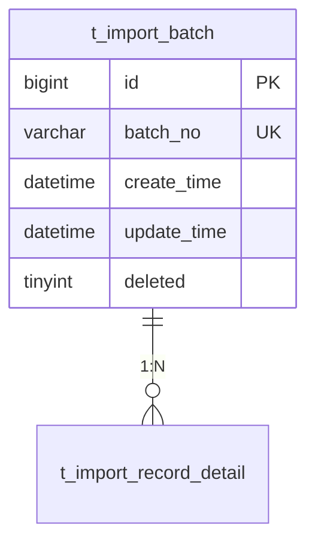

# PM 数据库设计 执行步骤

> 执行前必须 Read `${CLAUDE_SKILL_DIR}/../pm-common/project-management.md` 了解项目管理规范。

## 步骤 0：产物依赖门禁（硬门禁，可强制跳过）

1. 检查 `output/[项目名]/设计/[项目名]-功能详细设计.md` 是否存在
   - **不存在** → ❌ 停止：`请先执行 pm-design-1-func 完成功能详细设计`
2. 检查 `.pm-state.json` 中 `devPipeline` 的 `pm-design-1-func` status 是否为 `completed`
3. **用户强制跳过**：仅当用户明确说"跳过依赖检查"时可跳过，但必须记 `"dependencySkipped": true`

## 步骤 1：读取上下文

按顺序读取：

1. 【主输入】`设计/[项目名]-功能详细设计.md`（接口设计块 + 字段溯源表 + 实体）
2. `需求文档/*-PRD-*.md` 第五章「核心数据实体」（实体树，如存在）
3. `output/[项目名]/项目规范.md`「业务术语表」（`数据库字段` 列命名来源）
4. `.pm-state.json`：读 `devProjectType`（new/iteration）
5. 【历史参考·软参考】参考目录（默认 `D:/pm-ai/pm-ai-projects/output/`，可 `--ref`）里的历史 `设计/数据库/*-表结构.sql`，复用同义表/字段命名

## 步骤 2：实体抽取

从功能详细设计（模式 B 为推导实体）与 PRD ch5 实体树抽取实体：

- 实体 → 表：`import_batch` → `t_import_batch`、`import_record_detail` → `t_import_record_detail`
- 规则：`t_` 前缀 + snake_case；术语表 `数据库字段` 列若为空则按此规则补填/追加（append-only）

## 步骤 3：产出 ER 图 + 实体定义表 + DDL

### 3.1 ER 图（Mermaid，写入数据库设计.md）



### 3.2 实体定义表（与 DDL 逐字一致）

| 属性名 | 字段名 | 类型 | 约束 | 说明 |
|--------|--------|------|------|------|

### 3.3 DDL（物理模型写死，单源权威）

- 主键 `id BIGINT NOT NULL AUTO_INCREMENT PRIMARY KEY`（MyBatis-Plus `IdType.AUTO`）
- 公共字段：`create_time DATETIME DEFAULT CURRENT_TIMESTAMP`、`update_time DATETIME DEFAULT CURRENT_TIMESTAMP ON UPDATE CURRENT_TIMESTAMP`、`deleted TINYINT DEFAULT 0`
- 引擎 `InnoDB DEFAULT CHARSET=utf8mb4`
- 索引设计：唯一键（如 `batch_no`）、查询字段索引
- **新项目**：全量 `CREATE TABLE`，写入 `设计/数据库/[项目名]-表结构.sql`
- **迭代项目**：增量 DDL，写入 `设计/数据库/[项目名]-增量-[日期].sql`——新增表 `CREATE TABLE`、改表 `ALTER TABLE ... ADD COLUMN`，复用表不重复建并在文档标注「复用」
- 末尾附「PRD 字段 → DDL 字段」映射表（如 `batchNo→batch_no`、`createdAt→create_time`），供设计评审字段溯源核对

## 步骤 4：落盘与更新

### 4.1 写文档

- 新项目 → `设计/[项目名]-数据库设计.md`（ER + 实体定义表 + 映射表）
- 迭代项目 → `设计/[项目名]-数据库变更设计.md`

### 4.2 更新 .pm-state.json

`devPipeline` 插入/更新 `pm-design-2-db` 条目（splice，重跑先摘旧条目）：
`{"step":"pm-design-2-db","status":"completed","startedAt":null,"completedAt":"…Z","output":"设计/数据库/[项目名]-表结构.sql","counters":{}}`（迭代项目 output 写增量 DDL 路径）。时间戳 UTC 带 `Z`。

### 4.3 更新 README.md

`### 数据库设计（pm-design-2-db）` 章节追加一行（5 列：产物/路径/表数/生成时间/批次），
追加在产物清单末尾（`### 变更记录` 之前）。

### 4.4 更新项目规范.md

可补填「业务术语表」的 `数据库字段` 列（append-only，不删既有行）。

## 步骤 5：自检

1. 主键是 `id BIGINT` 自增，含 `create_time`/`update_time`/`deleted` 公共字段
2. 表名 `t_` + snake_case，字段 snake_case
3. ER 图是 Mermaid，标注 PK/FK/UK 与关系
4. 实体定义表与 DDL 逐字一致
5. 迭代项目产出增量 DDL，复用表未重复建
6. 有「PRD 字段 → DDL 字段」映射表
7. 时间戳 UTC 带 `Z`；devPipeline 条目 6 keys 齐全
8. README 表 5 列

## 步骤 6：会话内输出摘要

只回（不倒全文）：

```
✅ 数据库设计：`output/[项目名]/设计/[项目名]-数据库设计.md`（或 数据库变更设计.md）
✅ DDL：`output/[项目名]/设计/数据库/[项目名]-表结构.sql`（或 增量-[日期].sql）

- 表 [n] 个：t_xxx, t_yyy, …
- 项目性质：新项目（全量）/ 迭代（增量）
```
