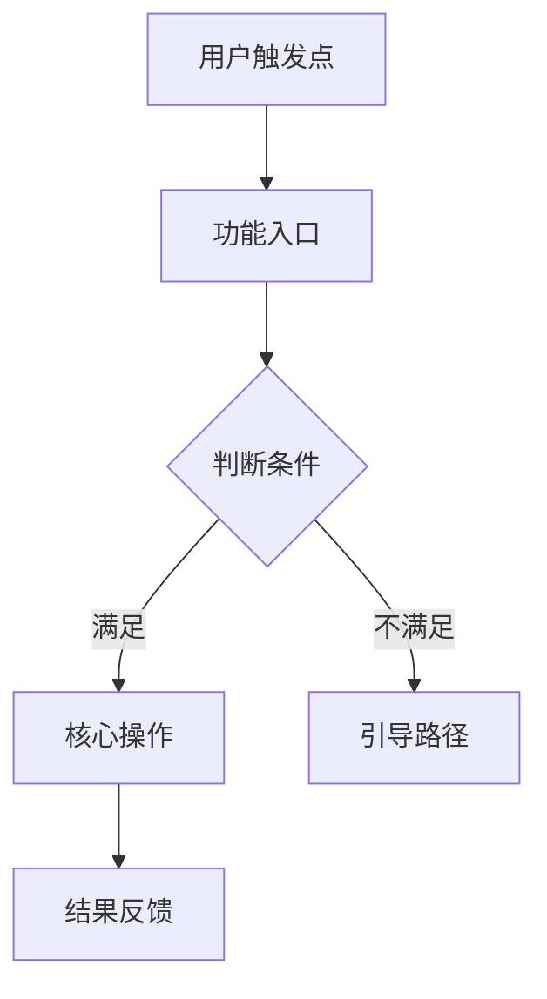

# PRD 文档模板

---

# [项目名称] 产品需求文档
**版本**：v1.0 | **状态**：草稿 | **日期**：[日期]
**作者**：[作者] | **审核**：待定

---

## 第一章 产品概述

### 1.1 产品背景
[产品诞生的业务背景和市场机会，2-3段]

### 1.2 产品目标
**用户目标**：[用户能通过产品解决什么问题]
**业务目标**：[产品带来的业务价值，可量化]
**技术目标**：[技术层面的目标，如性能指标]

### 1.3 目标用户
| 用户角色 | 描述 | 核心场景 | 预计占比 |
|----------|------|---------|---------|
| [角色1] | ... | ... | XX% |

### 1.4 版本范围
**本版本（v1.0）包含**：[功能列表]
**后续版本规划**：[未来版本的主要方向]

---

## 第二章 用户旅程与核心流程

### 2.1 用户旅程地图
[描述主要用户角色从发现产品到完成核心任务的完整旅程]

### 2.2 核心业务流程


---

## 第三章 功能需求

### 3.1 功能清单

| F 编号 | 模块 | 功能点 | 优先级 | 复杂度 | 依赖模块 |
|--------|------|--------|--------|--------|---------|
| F001 | [模块1] | [功能] | P0 | 高/中/低 | - |

> F 编号与 `需求分析报告.md` 的 F 编号一一对应，不得跳号、重号；新增功能从 `counters.F + 1` 续编。

### 3.2 详细功能说明

> 每个功能点独立成节，标题统一为 `#### F[编号] [功能名]`，例如 `#### F015 用户导出`。

#### F015 [模块名称]

**功能概述**：[一句话描述]

**页面/界面**：[对应的页面名称和 URL/路由]

**交互逻辑**：
1. 用户进入[页面]，看到[初始状态]
2. 用户执行[操作]，系统响应[行为]
3. [后续步骤...]

**字段说明**：
| 字段名 | 类型 | 长度 | 必填 | 默认值 | 说明 |
|--------|------|------|------|--------|------|
| [字段] | string | 100 | 是 | - | [说明] |

**使用组件**：`AForm` `AInput` `ASelect` `AButton`

**异常处理**：
- 网络错误：提示"网络异常，请重试"，使用 `AAlert` 展示
- 表单校验失败：字段下方红字提示，使用 `AForm` 校验能力

**优先级**：P0 | **预计工时**：前端 X天 / 后端 X天

---

## 第四章 接口列表

> 每个接口独立编号 `R[三位序号]`，从 `.pm-state.json` 的 `counters.R` 续编并回写；`关联 F 编号` 指向第三章的功能点。

| R 编号 | 方法 | 路径 | 关联 F 编号 | 说明 |
|--------|------|------|------------|------|
| R001 | GET | /api/xxx | F015 | [用途 / 入参要点 / 返回结构要点] |

---

## 第五章 非功能需求

### 5.1 性能要求
- 页面首屏加载：≤ 3秒（4G网络）
- 列表接口响应：≤ 500ms（P99）
- 并发用户数：≥ 1000（峰值）

### 5.2 安全要求
- 登录态：JWT Token，有效期 7天，可手动过期
- 权限控制：RBAC，菜单/按钮/数据三级权限
- 数据传输：HTTPS，敏感字段脱敏

### 5.3 兼容性要求
- 浏览器：Chrome 90+、Safari 14+、Edge 90+
- 移动端（如有）：iOS 14+、Android 9+
- 屏幕分辨率：1280px 宽以上

---

## 第六章 数据需求

### 6.1 核心数据实体
```
[实体1]
├── id: number（主键）
├── [字段1]: string（[说明]）
├── [字段2]: enum（[可选值]）
├── createdAt: datetime
└── updatedAt: datetime
```

### 6.2 数据统计需求
[需要统计的指标，如 DAU/转化率/完成率等]

---

## 第七章 运营配置需求

### 7.1 后台可配置项
| 配置项 | 类型 | 默认值 | 说明 |
|--------|------|--------|------|
| [配置项] | string | [默认] | [说明] |

---

## 第八章 验收标准

### 8.1 功能验收
| 功能点 | 验收标准 | 优先级 |
|--------|---------|--------|
| [功能] | [可观测、可测量的标准] | P0 |

### 8.2 性能验收
- [ ] 首屏加载 ≤ 3秒（弱网3G环境）
- [ ] 关键接口响应 ≤ 500ms

### 8.3 上线 Checklist
- [ ] 功能测试通过
- [ ] 性能测试通过
- [ ] 安全扫描通过
- [ ] 灰度发布方案确认

---

*本文档由 AI PM Assistant 辅助生成，需经产品团队评审后使用*
