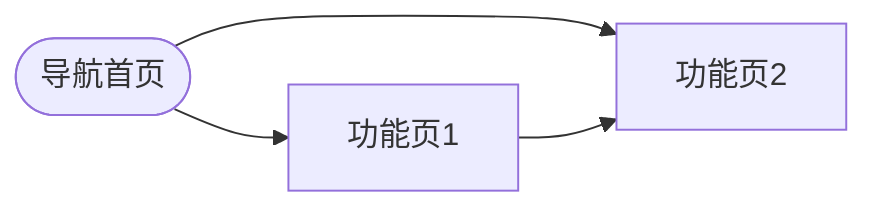

# PM 原型生成执行步骤

> 执行前必须 Read `${CLAUDE_SKILL_DIR}/../pm-common/project-management.md` 了解项目管理规范。

## 步骤 -1：加载项目状态

1. Read `output/[项目名]/.pm-state.json`（如存在）
   - 获取当前批次编号和 P 计数器（counters.P）
   - 检查 pm-prototype 的 status，如为 `in_progress` 则提示续做
2. 如果项目目录不存在，提示用户："建议先执行 pm-analyze 进行需求分析，还是直接创建项目骨架？"
   - 如果用户选择直接创建，则初始化 output/[项目名]/ 骨架（参考 project-management.md）
3. 更新 .pm-state.json 中 pm-prototype 的 status 为 `in_progress`

## 步骤 -0.5：产物依赖门禁检查（硬门禁，不可跳过）

**依赖检查**（不满足则停止执行）：

1. 检查 `output/[项目名]/analysis/analysis-report.md` 是否存在
   - **不存在** → ❌ 停止执行，输出：
     ```
     ❌ 前置依赖不满足：未找到需求分析报告。
     请先执行 pm-analyze 完成需求分析，再执行 pm-prototype。
     ```
   - **存在** → 继续
2. 检查 `.pm-state.json` 中 `pipeline` 的 pm-analyze status：
   - **不是 `completed`** → ❌ 停止执行，提示"pm-analyze 尚未完成"
3. **用户强制跳过**：仅当用户明确说"跳过依赖检查"时可跳过，但必须在 `.pm-state.json` 中 pm-prototype 的 pipeline 项记录 `"dependencySkipped": true`

**Blocker 门禁检查**：

4. Read `output/[项目名]/analysis/analysis-report.md` 的第 7 章（待澄清问题清单）
5. 统计风险等级为"高"且状态标记为"待确认"的问题数量（= Blocker 遗留数）
6. **Blocker 遗留 > 0** → 向用户输出：
   ```
   ⚠️ 需求分析中存在 [N] 个 Blocker 级问题未解决：
   1. [问题描述] — 风险等级：高
   2. ...
   建议先解决以上问题再生成原型。如确认可带问题推进，请回复"继续"。
   ```
   等待用户确认后继续
7. **Blocker = 0** → 继续

## 步骤 0：读取项目规范（规范引用铁律）

按顺序检查（**未读取不得进入步骤 1**）：
1. **【强制】** `output/[项目名]/project-spec.md`：提取组件使用约定、设计规范、已有接口清单
2. 当前目录 `CLAUDE.md`：提取设计规范、已有组件库约定、页面命名规则
3. `output/[项目名]/analysis/analysis-report.md`：提取端类型推荐和功能清单
4. 如果用户提供了参考的已有 HTML 文件路径，Read 该文件提取布局和组件使用风格

## 步骤 1：判断生成模式

- 用户提到"改一个页面"、"新增一个功能页"、"只需要 X 页" → **单页模式**
- 用户提到"新项目"、"完整原型"、"多个页面" → **全量模式**
- 不确定时询问："是需要完整的多页面原型站，还是只需要某个功能页面？"

## 步骤 2：确认参数

向用户确认（如未在需求中指定）：
- 项目名称（用于输出目录命名）
- 目标端（admin/h5/user-pc/miniapp，可多选）
- 核心功能模块（列表页/详情页/表单页/仪表盘等）

---

## 技术栈规范

### 脚本加载（必须严格按此顺序，放在 </body> 前）
```html
<script src="../../_shared/vendor/vue.global.prod.js"></script>
<script src="../../_shared/vendor/arco-vue.min.js"></script>
<script src="../../_shared/proto-utils.js"></script>
```

### CSS 引用（放在 <head> 中）
```html
<link rel="stylesheet" href="../../_shared/vendor/arco.css"/>
<link rel="stylesheet" href="../../_shared/theme.css"/>
```

### 关键约束（违反任何一条会导致页面空白）
1. `v-cloak` 必须在 `<div id="app">` 上，不能在 `<body>` 上
2. `<style>` 里必须有 `[v-cloak]{display:none}`
3. 组件名必须用 `<a-*>` 前缀（`<a-button>` `<a-input>` `<a-menu>` 等）
4. 自定义元素（含连字符的标签）禁止自闭合：必须 `<icon-home></icon-home>`，不能 `<icon-home/>`
5. Vue mount：`createApp({setup(){...}}).use(ArcoVue).mount('#app')`
6. ArcoVue 只有 `window.ArcoVue`，没有 `window.ArcoVueIcon`，不要 `.use(ArcoVueIcon)`

## Mock 数据规范

所有 Mock 数据必须集中定义：
```js
const MOCK_DATA = {
  list: [
    { id: 1, title: '...', status: '进行中', date: '2026-09-01', ... },
    // 至少 5 条
  ],
  // 其他数据集
}
```

## 状态切换规范

每个数据页面的内容区必须支持四状态：
```html
<div v-if="pageState==='loading'" ...><a-spin tip="加载中..."></a-spin></div>
<a-result v-else-if="pageState==='error'" status="500" ...></a-result>
<div v-else-if="pageState==='empty'" ...><a-empty></a-empty></div>
<template v-else><!-- 正常内容 --></template>
```

proto-toolbar 按钮切换这四个状态。

## 步骤 3：读取基础模板

使用 Read 工具读取目标端的 `_base.html`：
- admin：`prototypes/admin/_base.html`
- h5：`prototypes/h5/_base.html`
- user-pc：`prototypes/user-pc/_base.html`
- miniapp：`prototypes/miniapp/_base.html`

根据目标端，还需读取对应的端规格文件：
- `${CLAUDE_SKILL_DIR}/prompts/admin-spec.md`（管理后台）
- `${CLAUDE_SKILL_DIR}/prompts/h5-spec.md`（移动端H5）
- `${CLAUDE_SKILL_DIR}/prompts/user-pc-spec.md`（用户前台PC）
- `${CLAUDE_SKILL_DIR}/prompts/miniapp-spec.md`（微信小程序）

## 步骤 4：生成页面规则

1. **基于 `_base.html` 生成**：必须先 Read 目标端的 `_base.html`，复制其结构，只替换内容区（`PAGE_CONTENT_SLOT` 注释位置）
2. **Mock 数据真实感**：数据内容要贴合项目业务，不要用 item1/item2 这样的占位
3. **交互完整性**：表单字段要有 v-model 绑定，按钮要有 @click 处理函数（即使只是改状态）
4. **导航连通**：页面间跳转用相对路径，`index.html` 要能跳到所有功能页
5. **注释清晰**：每个主要功能块前加简短注释说明用途

**单页模式**：只生成用户指定的那一个 HTML 文件，不生成 index.html 和其他页面。

## 步骤 5：生成导航索引页（全量模式）

在输出目录生成 `index.html`，列出所有生成的页面及描述。单页模式跳过此步骤。

## 步骤 6：输出完成报告

生成完成后必须输出：

1. 文件列表（路径 + 页面描述）
2. Mermaid 页面导航地图：

3. 打开方式说明：将 `output/prototypes/[端类型]/[项目名]/index.html` 拖入浏览器即可

## 步骤 7：更新项目管理文件

### 7.1 更新 README.md
在 `output/[项目名]/README.md` 的"原型（pm-prototype）"表格中追加本次产物行，标注端类型和页面数。

### 7.2 更新 .pm-state.json
- `pipeline` 中 pm-prototype 的 `status` → `completed`，填入 `completedAt` 和 `output`
- `counters.P` 更新为最后一个 P 编号

### 7.3 追加 project-spec.md
如果在生成过程中发现了新的组件使用约定，追加到 project-spec.md 的"组件使用约定"表格。

### 7.4 页面编号
每个生成的页面在 index.html 导航页中标注 P 编号：
```
P001 仪表盘 — dashboard.html
P002 用户列表 — user-list.html
```

### 7.5 产物头部标注
在每个 HTML 文件的第一行注释中标注：
```html
<!-- 批次：B1 | P001 | 生成时间：2026-09-26 15:00 | pm-prototype v2.0.0 -->
```

## 输出目录结构

```
output/prototypes/[端类型]/[项目名]/
├── index.html          # 导航索引，列出所有页面（全量模式）
├── [功能1].html
├── [功能2].html
└── ...
```
